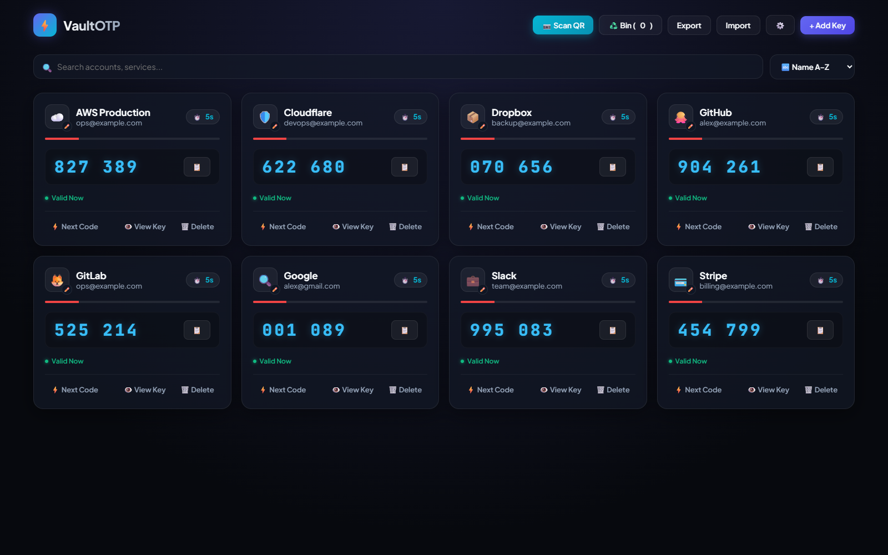
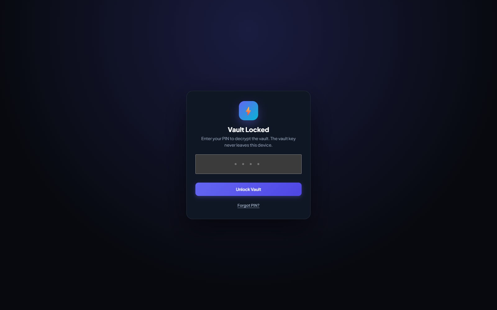
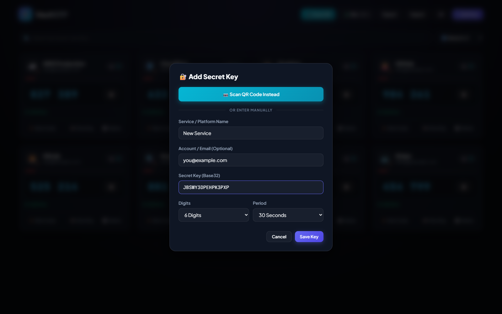
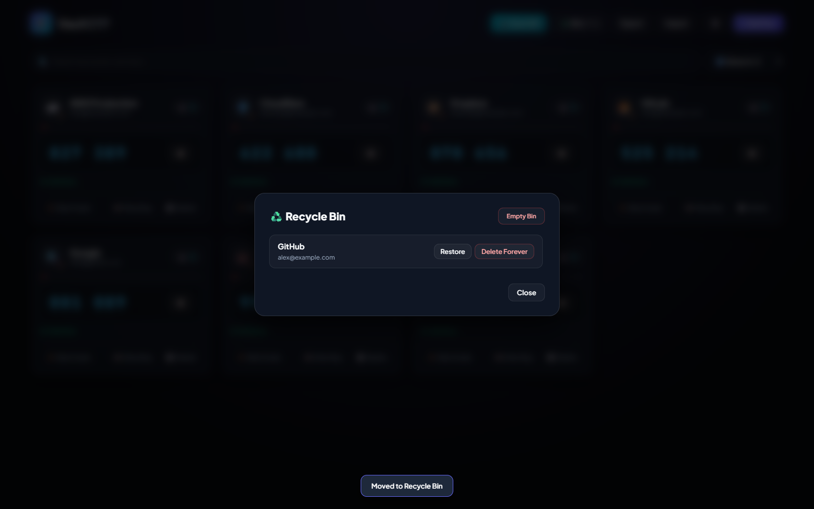
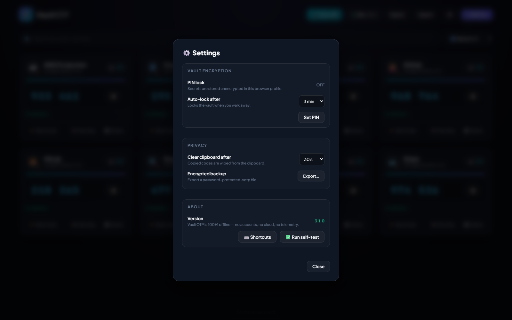

# ⚡ VaultOTP

[](https://github.com/OWNER/vaultotp/actions/workflows/ci.yml)
[](https://github.com/OWNER/vaultotp/releases)
[](https://github.com/OWNER/vaultotp/releases)
[](LICENSE)
[](#downloads)
[](tests)
[](docs/PRIVACY.md)

**A private, fully offline TOTP authenticator — one codebase, three products: Web app, Windows EXE and Android APK.**

VaultOTP generates the same 6‑digit (or 8‑digit) two‑factor codes as Google Authenticator, Authy, Microsoft Authenticator or Aegis — but it has no account, no sync server, no analytics and no third‑party requests. Open it once, and it works forever, even in airplane mode.

```
┌──────────────┬─────────────────────┬────────────────────────┐
│  🌐 Web app  │  🖥️ Desktop (EXE)   │  📱 Android (APK)      │
│  PWA, offline│  portable + installer│ signed debug/release  │
└──────────────┴─────────────────────┴────────────────────────┘
```

---

## Screenshots

| Vault (4 cards per row on wide screens) | Locked (encrypted) |
|---|---|
|  |  |

| Add key | Recycle bin | Settings |
|---|---|---|
|  |  |  |

| Phone (Android / PWA) |
|---|
|  |

---

## Table of contents

- [Why another authenticator?](#why-another-authenticator)
- [Features](#features)
- [Downloads](#downloads)
- [Quick start](#quick-start)
- [How it works (30‑second version)](#how-it-works-30-second-version)
- [Security model](#security-model)
- [Keyboard shortcuts](#keyboard-shortcuts)
- [Project structure](#project-structure)
- [Testing](#testing)
- [Test on your phone](#test-on-your-phone-same-wi-fi)
- [Build from source](#build-from-source)
- [Import & export format](#import--export-format)
- [FAQ](#faq)
- [Roadmap](#roadmap)
- [Contributing & licence](#contributing--licence)

---

## Why another authenticator?

Most TOTP apps ask you to trust a cloud. VaultOTP takes the opposite approach:

| | VaultOTP | Typical cloud authenticator |
|---|---|---|
| Account required | **No** | Usually yes |
| Secrets leave the device | **Never** | Uploaded for backup/sync |
| Works offline | **Always** | Often needs a session refresh |
| Network requests at runtime | **Zero** | Analytics + sync |
| Encrypted at rest | **Optional AES‑256‑GCM PIN lock** | Vendor‑dependent |
| Auditable source | **Yes — this repo** | Rarely |
| Ads / tracking / telemetry | **None** | Common |

---

## Features

**Core**
- 🔐 TOTP (RFC 6238) with **SHA‑1 / SHA‑256 / SHA‑512**, 6 or 8 digits, 30 s or 60 s periods
- 📷 **QR scanning** for `otpauth://` codes (camera on web/Android, file upload fallback on desktop)
- 🔗 Paste an `otpauth://` URI straight into the secret field — it is parsed and validated
- 🧮 Codes are constant‑time correct: the exact RFC 6238 test vectors run as an in‑app self‑test

**Privacy / security**
- 🔒 **PIN lock with real encryption** — PBKDF2‑SHA256 (310 000 iterations) → AES‑256‑GCM, random salt + IV per save
- ⏱️ Configurable **auto‑lock** (1/3/5/15 min or never) and a one‑click **Lock** button
- 📋 **Clipboard auto‑wipe** (15/30/60 s) so codes do not sit in the clipboard
- 🙈 Secret keys stay **masked** in the DOM until you explicitly reveal them
- 📦 **Password‑protected `.votp` backups** (same AES‑256‑GCM envelope)
- 🚫 Zero third‑party requests: fonts, icons and the QR decoder are all bundled locally
- 🧱 Renders with no `eval`, no `new Function`, no `document.write` (enforced by tests)

**Usability**
- ♻️ **Recycle bin** — deleted keys can be restored or purged
- ⚡ One‑tap copy, per‑card progress ring, "Next Code" step preview
- 🎨 Emoji icon picker with automatic service detection
- 🔎 Instant search, four sort modes, multi‑select **export** and **import** with duplicate detection
- 🧱 Responsive grid: **4 cards per row** on wide screens, 3 on laptops, 2 on tablets, 1 on phones — cards reflow with container queries so nothing is cramped
- ⌨️ Desktop keyboard shortcuts, native Windows menu, multi‑instance protection
- 📲 Installable **PWA** — works offline after the first load

---

## Downloads

| Platform | Artifact | Where |
|---|---|---|
| Web (any browser) | `web/index.html` (served) or the single file `web/VaultOTP.html` | [Releases](../../releases) or GitHub Pages |
| Windows | `VaultOTP-<version>-portable.exe` (no install) and `VaultOTP-Setup-<version>.exe` | [Releases](../../releases) |
| Android | `VaultOTP-<version>.apk` | [Releases](../../releases) |
| macOS / Linux | `.dmg` / `.AppImage` built by CI | [Releases](../../releases) |

> The portable EXE needs no administrator rights. The Android APK is signed with the debug key for side‑loading; see [docs/BUILD.md](docs/BUILD.md) for a release signing setup.

---

## Quick start

### Web
```bash
npm install
npm run dev          # → http://localhost:4173
```
Or simply open `web/VaultOTP.html` by double‑clicking it — everything is inlined, no server needed.

### Windows EXE
```bash
npm install
npm run build:desktop     # → dist/desktop/VaultOTP-<version>-portable.exe
```

### Android APK
```bash
npm install
npm run build:android     # → needs a JDK 21 + Android SDK 36 (see docs/BUILD.md)
```

### First run
1. Open the app → **+ Add Key** (or **📷 Scan QR**).
2. Paste the Base32 secret or scan the service's QR code, then **Save Key**.
3. Tap a code to copy it. Optional: **⚙️ → Set PIN** to encrypt the vault.

---

## How it works (30‑second version)

1. The service gives you a **Base32 secret** (manually or as a QR code).
2. VaultOTP decodes that secret to raw bytes with the browser's `crypto.subtle`.
3. Every 30 seconds it computes `HMAC-SHA1(secret, floor(unixTime / 30))`.
4. Dynamic truncation picks 4 bytes out of the digest, then `mod 10^digits`.
5. The result is your 6‑digit code — identical to what the server computes.

No secret ever leaves `localStorage`/the app sandbox; with a PIN set, that storage is an AES‑256‑GCM blob whose key exists only in memory while the vault is unlocked.

Full details, diagrams and the exact byte layout: **[docs/HOW-IT-WORKS.md](docs/HOW-IT-WORKS.md)**.

---

## Security model

```
PIN ──PBKDF2-SHA256(310k, 16-byte salt)──► 256-bit key ──AES-256-GCM(random IV, AAD)──► localStorage blob
                                                                                        { kdf, iv, ct }
```

- The PIN/key is **never** written to disk. Forgetting the PIN means the vault cannot be decrypted — restore a backup instead.
- Five wrong PINs trigger a 30‑second cool‑down; the vault is wiped from memory on lock.
- The desktop build blocks every non‑`file://` request, denies new windows and only grants the camera permission.
- The app contains no network code at all — grep `fetch`/`XMLHttpRequest` and you will find them only in the service worker.

Read the full threat model and what is *out* of scope: **[SECURITY.md](SECURITY.md)**.

---

## Keyboard shortcuts

| Key | Action |
|---|---|
| `/` | Focus search |
| `N` | Add a new key |
| `S` | Scan a QR code |
| `L` | Lock the vault |
| `,` | Open settings |
| `Esc` | Close the top dialog |

Desktop menu equivalents: `Ctrl+L` (lock), `Ctrl+,` (settings).

---

## Project structure

```
├── src/
│   ├── app.html                 ← the entire app: markup + CSS + JS (single source of truth)
│   └── fonts/                   ← self-hosted variable fonts (woff2)
├── vendor/jsQR.js               ← bundled QR decoder (Apache-2.0)
├── tools/
│   ├── build.mjs                ← builds web/, single-file HTML, syncs mobile/www
│   ├── serve.mjs                ← zero-dependency dev server (HOST=0.0.0.0 → phone over Wi-Fi)
│   ├── gen-icons.mjs            ← regenerates launcher/splash artwork (Capacitor)
│   ├── brand-exe.mjs            ← applies icon + version metadata to the Windows EXE
│   └── build-android.mjs        ← gradle wrapper for the APK
├── desktop/main.js              ← hardened Electron shell for the EXE
├── mobile/                      ← Capacitor project (android/)
├── tests/                       ← RFC 6238 vectors + repository hygiene checks
├── docs/                        ← HOW-IT-WORKS, ARCHITECTURE, BUILD, PRIVACY, FAQ
└── .github/workflows/           ← CI, release (EXE + APK + DMG), GitHub Pages
```

`web/`, `mobile/www/` and `dist/` are generated — never edit them by hand.

---

## Testing

```bash
npm test
```

30 checks, no test framework to install:

- **RFC 6238 vectors** — the official SHA-1, SHA-256 and SHA-512 test vectors, zero-padded 6-digit codes, 60-second periods and >32-bit counters.
- **Repository hygiene** — no `eval`/`new Function`/`document.write`, no remote asset URLs, no committed credentials or demo secrets, and every `onclick` handler and DOM id referenced in `src/app.html` really exists.

Manual release checklist (APK install, QR scan, PIN + reload, airplane mode, `.votp` contents): **[docs/TESTING.md](docs/TESTING.md)**.

---

## Test on your phone (same Wi-Fi)

```bash
npm run dev                       # prints http://<your-lan-ip>:4173 — open it on the phone
DIR=release PORT=8081 node tools/serve.mjs   # serves the APK so the phone can download it
```

1. Connect the phone to the same Wi-Fi as the PC.
2. Open the LAN URL in Chrome → menu → **Add to Home screen** for the PWA.
3. Or grab the APK at `http://<your-lan-ip>:8081/VaultOTP-<version>.apk` and sideload it.

If the phone cannot reach the PC, allow Node through the firewall:

```powershell
netsh advfirewall firewall add rule name="VaultOTP LAN" dir=in action=allow protocol=TCP localport=4173,8081
```

---

## Build from source

```bash
npm install
npm test               # 30 tests: RFC 6238 vectors + hygiene checks
npm run build          # web/ + single-file HTML + mobile/www
npm run build:all      # EXE + APK
```

Requirements, Android signing, macOS notarisation and CI usage are documented in **[docs/BUILD.md](docs/BUILD.md)**.

---

## Import & export format

Plain export (`.json`):

```json
{
  "app": "VaultOTP",
  "kind": "plaintext-backup",
  "version": 3,
  "exportedAt": "2025-01-01T00:00:00.000Z",
  "accounts": [
    {
      "id": "acc_…",
      "name": "GitHub",
      "account": "you@example.com",
      "secret": "JBSWY3DPEHPK3PXP",
      "digits": 6,
      "period": 30,
      "algorithm": "SHA-1",
      "icon": "🐙"
    }
  ]
}
```

Encrypted export (`.votp`): `{ "enc": true, "kdf": { "salt", "iterations" }, "iv": "…", "ct": "…" }`.
Import also accepts a bare array of accounts and `otpauth://` URIs — duplicates are detected and skipped.

---

## FAQ

**Where is my data stored?**
In this browser profile / app sandbox only (`localStorage`, key `vaultotp_vault_v3`). With a PIN set that value is ciphertext.

**Can I use my existing Google Authenticator keys?**
Yes — export them from the Google Authenticator "transfer accounts" QR, scan it into VaultOTP, or paste the Base32 secret.

**Does it need internet?**
No. The only optional network use is the browser's service worker cache on first install.

**What if the codes are wrong?**
Your system clock must be within ~30 s of real time. Codes are computed from the device clock, exactly like every other TOTP app.

More: **[docs/FAQ.md](docs/FAQ.md)**.

---

## Roadmap

- [ ] Folder/tag grouping and drag-to-reorder
- [ ] Steam Guard (custom alphabet) support
- [ ] WebAuthn/passkey unlock for the desktop build
- [ ] Bulk `otpauth://` text import screen
- [ ] Localised UI (Hindi, Marathi, Spanish)
- [ ] Optional encrypted cloud‑free device-to-device transfer via QR

Have an idea or a bug? Open an issue — see [CONTRIBUTING.md](CONTRIBUTING.md).

---

## Contributing & licence

PRs are welcome. Please read [CONTRIBUTING.md](CONTRIBUTING.md) and [SECURITY.md](SECURITY.md) first (never paste real secrets into an issue).

- Code: **MIT** © VaultOTP contributors
- Bundled QR decoder: **Apache‑2.0**, see [vendor/NOTICE.md](vendor/NOTICE.md)
- Fonts: **SIL Open Font License 1.1** (Plus Jakarta Sans, JetBrains Mono)

> ⚠️ **Back up your secrets.** An authenticator without cloud sync means a lost device is a lost vault. Export a backup after adding keys.
